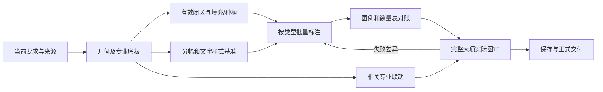

# 全套CAD施工图：经验调用与工序衔接

本文件把已有方法串成完整工作链，不接管项目业务状态。当前范围、执行者、优先级、原件与候选仍以项目唯一入口/MD及原生任务为准。已验且未受影响的阶段直接继承，不把总流程变成每轮全量重做。

## 调用入口

`scripts/resolve_cad_method.py`按当前对象/工序返回专项Skill、已有方法来源、实现/证据位置和适用边界。明确模块用`--module tree`等；尚未分型用`--query "乔木串线中心"`，多个模块命中时结合真实对象选，不凭关键词自动写图。`--workflow`只查看工序与依赖，不新增台账或审批。索引位于`references/cad-method-index.json`，只存导航，不复制整段经验或旧任务。

每次新任务/恢复/纠正，调用模块→读相关有效Skill与来源小节→核当前条件→实际已验证接口→原生后态/真实图面。索引可达、文件存在和读取成功不等于已调用或已验收；不能由召回器生成CAD授权。缺命中再沿既有`loop_recall.py discover`/CAD_TECHNICAL_RECALL定向补查，不认定没有经验。

各工序发现问题或出现重复返修时，统一沿[问题分析与修复](drawing-change-workflow.md#问题分析与修复)定位失败层次、调用已验经验、局部解决并核真实效果，再更新对应模块；不把标注排版当成所有错误的通用修复。几何、填充、原生对象、文字、布局、数量及交付各保留自己的判定依据，跨工序只核真实依赖。沿原项目清单归并可同做的动作，原要求及独立后态不能随合批丢失。

## 全套内容与依赖

| 模块 | 必须解决的实际内容 | 进入后续的有效输入 |
|---|---|---|
| 来源/版本/专业清单 | 正式底稿、实测用途、最后纠正、专业目录、完整外参、原件/候选身份与保存边界 | 当前输入与本次允许改动明确 |
| 底板几何/工程接口 | 道路中边线、桥界、岸线/坡脚/轴线、平台台阶、坝墙、节点/详图；旧失效实体清理、圆弧稀疏拟合、真实XYZ | 受影响几何及首末接口验收；不凭空设计构造 |
| 原生专业底板组织 | 需要本地可编辑的园建复制、真正地形外参、源目标映射、重复底板/块/组及置石组织 | 本专业真实可编辑有效底板，无旧重影 |
| 范围识别/填充 | 草地/地被/农田/铺装等真实闭区、岛环、硬质扣除、图案格式与XY/Z回位 | 本次有效分区和原生面积 |
| 种植本体/分组 | 最后实测位置、图例/块变换、唯一实物、真实树组/分区身份 | 真实成员/中心/品种与独立期望数量 |
| 分幅/布局与文字基准 | 完整覆盖、比例/转角/图种、图框图签、字形/纸面字高、网格和指北针 | 各注实际纸面方向、空间和样式；可提前准备，落图前核定 |
| 六类标注 | 乔木、灌草、坐标、标高、索引、线性/角度/R尺寸各自语义和原生拓扑 | 同类成批落图与实际读回，联动邻注同时核 |
| 图例/数量表/说明 | 独立实物/分区全集、精确面积与显示量、规格、真实表单元格及缓存显示 | 平面—标注—图例—统计表一致，未知独立挂起 |
| 专业联动 | 园建、种植、给排水及现有其它专业的最新底板、接口与引用同步 | 相关专业按相同有效几何核接口，表达按各专业要求 |
| 整体图审/审美 | 范围、层级、就近排布、跨类型压线交叉、全部受影响分幅、历史意见完整性 | 项目端按原ID统一验收整个大项，集中返修 |
| 出图/交付/收口 | 可编辑DWG、原生对象、外参/字体等依赖、目录图号、按需要PDF、来源标识、实际保存和必要的交付打开检查 | 正确版本与实际可用成果；验收后保护关闭本任务宿主 |

箭头表示真实输入依赖，图审发现底板或分区错误时回到相应更早模块，不只改末端文字。用户规定“整张底板验收后再填充”时遵从该阶段门；一般局部未知只停真实依赖，不锁住其它独立专业/区域。已核阶段没有改变不重跑。

## 换底与整册修改

1. **先定两份输入。** 源取最后确认且保留人工手改的园建保存件；目标取已含最近种植调整的累计稿。若同名文件指纹变了，只对有差异的原生内容及依赖作比较，保留新手改，不用旧备份回盖。
2. **按归属换底。** 在目标副本区分旧园建、种植自有对象及地形外参。把应替换的园建实体和所需块/组定义按原世界坐标复制；移除对应旧底板，保护目标内种植本体、分区、图例、原生引线和布局。实际地形仍只引用一次。核同名定义、重复底板、关键对象的两处以上位置、模型与受影响视口显示；一个可见的外参不能证明底板可编辑。 增量换底优先用上次复制留下的源对象→目标对象对应表，再核当前类型、专业归属和几何。两个重合对象可能分别属于园建和种植；仅凭同形、同坐标或相同句柄不能删除。对应表失效的只重新辨认该对象，本轮新增复制也留下对应关系。 已移位或取消的构件，用旧位置再找一次是否曾复制到其他图层；只清理能由原生轮廓（含圆弧凸度、允许首点/方向不同）、来源和构件用途共同证实的旧件。在当前 CAD 视图看接口是否仍有双线，不整层删除或关闭。
3. **按图号走完整册。** 先取正式专业目录，再对真实图框、图签、布局和视口；一张可能有两个分幅，不能按 DWG 数或分幅分母估张数。沿变更范围确定各张图是改绘、核后沿用，还是缺实测依据暂缓；同时检查对应详图、旧构造及冲突标注和索引。通用大样是否仍适用要回到平面核对。已有布图可用则保留，新出现的实物应有去处；不编造工程量、高程、隐蔽构造或签章。
4. 保存并在当前文档查实际模型及受影响布局，用原图号核齐成套成果。普通改稿不逐步重开或导出检查 PDF；只有发布正式图册、打印表现有实证疑点或用户要求时才走出图检查。

## 施工图各专业的边界

按本套实际专业目录覆盖园建/景观、种植、给排水及确有的结构/电气等，不因为通用列表出现某专业就新造该工程设计。给排水的管径、标高、坡度、节点与运行功能需要原设计/实测依据；只能沿本次授权同步已明确平面和接口，未知设计判断只挂局部，不自动算出新设计。标准大样、断面、节点、索引引用与实际平面同步，不能只修总平面。

## 修改、判定和纠正分开

- 修改器按当前数据化job实施；判定从原要求和真实对象全集独立建立，不能只验自己生成了什么。
- 每类有独立语义标准，同时接受共用范围/原生/显示/保存保护检查。审美分层在语义正确后核，不能用一个碰撞分数或截图数替代全部。
- 新意见原话/图片/数值/例外保留于项目唯一MD；模块内更新可复用规则、失效条件及反例，项目参数不复制到通用Skill。相冲条款明确替代，实际消费者和当前回执随之更新。
- 经验按“用户要求/已证技术/候选方法/当前图验收”分层，调用已有成熟公式与原生接口优先。没有适用证据不自动猜ABI、改用散件或扩大发挥。
- 普通同类执行走一次基线、多对象批次、增量自检和整项验收；所有模块共用[检查触发表](annotation-control.md#检查按触发条件执行不按每次微调重复)，不在各模块/项目端叠加同义全量检查。成熟CAD区域截图优先，难点局部回查不产生无限单对象编译/启动/出图/重开。改方法只验证受影响机制，旧覆盖未失效则复用，效果在自然批次核。

## 最终全套核对

原ID完整性；原件保护；本地可编辑与外参组织；最新几何/填充/种植；六类标注；图例/数量表/说明；实际专业接口；图框/图名/图号/目录；源与候选指纹；实际保存及所有受影响图面；仅遇持久性问题或约定交付要求时另行重开。正式PDF须绑定正确文档与纸面参数，不将侧数据库缓存或旧审图包作为新交付。只有全套实际完成才核销项目/停止监督。
